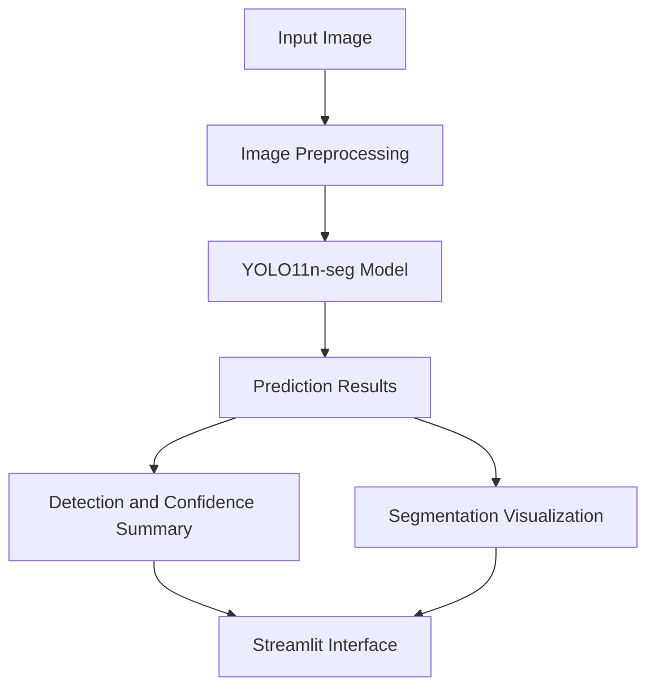

#  CrackVision — AI-Powered Surface Defect Detection & Segmentation

<p align="center">
  
  
  
  
</p>

<p align="center">
  <strong>Detect. Segment. Visualize. Inspect.</strong>
  <br/>
  An end-to-end computer vision application for identifying and visualizing surface defects using deep learning.
</p>

<p align="center">
  <a href="https://crackvision-qvv1.onrender.com/">
    
  </a>
  <a href="https://github.com/Priyanshu-Technologies/CrackVision">
    
  </a>
</p>

<p align="center">
  
  
  
  
  
  
</p>

---

## 📌 Overview

**CrackVision** is an AI-powered surface inspection project that uses deep learning to identify potential defects in images and highlight their locations through segmentation.

Built around a YOLO11n segmentation model and a Streamlit interface, CrackVision brings model inference, visual analysis, and application deployment together in one practical computer vision workflow.

Rather than simply returning a class label, the application visualizes the model's predictions so that users can inspect where potential defects occur in the input image.

The project explores the complete lifecycle of a computer vision system—from dataset exploration and annotation validation to model training, evaluation, inference, testing, and deployment.

###  Project objectives

- Detect potential surface defects in input images.
- Generate segmentation visualizations for predicted defect regions.
- Display prediction confidence and detection counts.
- Provide an accessible web interface for image-based inspection.
- Support local execution and Docker-based deployment.
- Establish a foundation for browser-based live camera inspection and future defect measurement.

##  Live Demo

**Try CrackVision:** https://crackvision-qvv1.onrender.com/

The deployed application provides access to the CrackVision interface and image-based inference.

> **Deployment note:** The current live camera implementation uses OpenCV device access, which works with cameras available to the local machine or a suitably configured local Docker container. Render cannot directly access a webcam connected to your personal computer. Browser-based camera capture for the hosted application remains a separate implementation task.

##  Features

| Feature | Description |
|---|---|
| Image upload | Upload supported image formats for inspection. |
|  Deep learning inference | Run predictions using trained YOLO11 segmentation weights. |
|  Segmentation visualization | Overlay model predictions on the input image. |
|  Prediction summary | Display detected instance counts and confidence information. |
|  Confidence threshold | Adjust the confidence threshold used during inference. |
|  Model experiments | Compare trained models evaluated at different input resolutions. |
|  Local camera inspection | Inspect frames from a locally accessible camera. |
|  Web application | Interact with the model through a Streamlit interface. |
|  Docker support | Package the application and its runtime dependencies into a container. |
|  Automated tests | Test selected application utility functions using pytest. |

*Feature availability depends on the execution environment. Local camera access and hosted browser camera access are not equivalent.*

##  Application Preview

Visit the live application to explore the current interface.

Recommended screenshots to add to this README:

1. **Application interface** — the main CrackVision page.
2. **Image inspection** — an uploaded image with the predicted segmentation overlay.
3. **Prediction summary** — the detection count and confidence information.
4. **Local camera inspection** — a working camera feed with annotations.

Save screenshots in a repository directory such as `docs/images/` and embed them below once captured.

```markdown


```

These are example image paths, not existing screenshots. Add the actual image files before enabling the embeds.

##  Model Architecture

CrackVision uses **YOLO11n-seg**, a lightweight YOLO11 instance segmentation model.

The model is designed to predict defect locations and segmentation information rather than only assigning a label to an entire image.

### Inference workflow



### Why YOLO11n-seg?

- **Detection and segmentation:** Combines localization with segmentation predictions.
- **Compact model:** The nano variant is a practical starting point for resource-conscious deployment.
- **Visual interpretability:** Predictions can be drawn over the original image.
- **Flexible inference:** The model can be called from a Python application.
- **Deployment potential:** Supports experimentation with local, containerized, and hosted inference.

The model's actual capabilities depend on its training data, annotation quality, learned features, and evaluation results.

### Current model scope

The current trained model uses a single class:

| Class ID | Class name |
|---:|---|
| 0 | `crack` |

Although CrackVision is presented as a surface defect inspection project, the current model should not be interpreted as a validated multiclass classifier for every possible defect type.

##  Model Evaluation

Two input-resolution experiments were recorded during model evaluation.

| Metric | Standard resolution (640) | Higher resolution (960) |
|---|---:|---:|
| Mask precision | 0.7763 | 0.7371 |
| Mask recall | 0.5991 | 0.6426 |
| Mask mAP@50 | 0.6383 | 0.6152 |
| Mask mAP@50–95 | 0.2156 | 0.2031 |
| Validation segmentation loss | 1.2028 | 1.1580 |

*Values are from the recorded evaluation experiments and are rounded for readability. Confirm the associated evaluation notebook and dataset split before publishing these values as final benchmark results.*

### Understanding the metrics

- **Mask precision:** Measures how many predicted positive instances are correct under the evaluation matching criteria.
- **Mask recall:** Measures how many ground-truth instances are successfully detected.
- **Mask mAP@50:** Measures mean average precision for segmentation masks at an intersection-over-union threshold of 0.50.
- **Mask mAP@50–95:** Evaluates mask average precision over multiple intersection-over-union thresholds from 0.50 to 0.95.
- **Validation segmentation loss:** Measures a component of the model's segmentation error on validation data; lower is generally preferable when comparing otherwise equivalent evaluations.

### What do these results tell us?

The 640-resolution experiment recorded higher mask precision and mAP values, while the 960-resolution experiment recorded higher mask recall and lower validation segmentation loss.

This illustrates an important practical trade-off: increasing input resolution does not guarantee better overall segmentation performance.

The best configuration depends on the evaluation metric, inference speed, hardware resources, and the intended inspection environment.

These results are experimental measurements, not a guarantee of production accuracy. Further evaluation on representative, independently held-out images is necessary before using the system for consequential inspection decisions.

##  Technology Stack

<p>
  
  
  
  
  
  
  
  
  
  
  
</p>

| Technology | Purpose |
|---|---|
| Python | Application and inference logic |
| Ultralytics YOLO11 | Model inference and segmentation |
| OpenCV | Image processing and local camera access |
| NumPy | Image-array operations |
| Pillow | Image loading and conversion |
| Streamlit | Interactive web interface |
| Pandas | Data analysis and exploration |
| Matplotlib | Dataset and training visualizations |
| PyYAML | Dataset configuration handling |
| pytest | Automated testing |
| Docker | Containerization |
| Render | Hosted application deployment |
| Git and GitHub | Version control and project hosting |

##  Project Architecture

```text
CrackVision/
│
├── app.py
├── Dockerfile
├── .dockerignore
├── .gitignore
├── requirements.txt
├── pyproject.toml
│
├── models/
│   ├── crackvision-yolo11n-seg-best.pt
│   └── crackvision-yolo11n-seg-960-best.pt
│
├── notebooks/
│   ├── 01_dataset_exploration.ipynb
│   ├── 02_model_training.ipynb
│   ├── 03_model_evaluation.ipynb
│   └── 04_inference_pipeline.ipynb
│
├── src/
│   └── crackvision/
│       ├── batch_utils.py
│       ├── image_utils.py
│       └── inference_utils.py
│
└── tests/
    └── test_image_utils.py
```

The dataset directory is intentionally excluded from the public repository to avoid committing a potentially large collection of images and annotations.

The tree above represents the intended project organization; verify the current repository before treating every listed file as present.

##  Getting Started

### Prerequisites

- Python 3.11 or a compatible Python version supported by the installed dependencies.
- Git.
- The CrackVision model weights.
- Sufficient RAM and disk space for the selected model and its dependencies.

A dedicated virtual environment is recommended to keep project dependencies isolated.

### 1. Clone the repository

```bash
git clone https://github.com/Priyanshu-Technologies/CrackVision.git
cd CrackVision
```

### 2. Create a virtual environment

On Linux:

```bash
python3 -m venv .venv
source .venv/bin/activate
```

### 3. Install dependencies

```bash
python -m pip install --upgrade pip
pip install -r requirements.txt
```

**Resource note:** Ultralytics and its deep learning dependencies can require significant disk space. Check available disk space before installing, and avoid installing duplicate frameworks or GPU-specific packages unnecessarily.

For CPU-only environments, choose a compatible CPU build of PyTorch when configuring the environment. Follow the official installation instructions for your operating system and Python version.

### 4. Verify model weights

Ensure the trained model files exist in the `models/` directory.

```bash
ls -lh models/
```

The application expects the model paths configured in `app.py`. If the files are stored elsewhere, update the configuration accordingly.

Model weights are binary artifacts and may not be available if you clone a repository version that excludes them. In that case, obtain the authorized weights separately.

### 5. Run CrackVision

```bash
streamlit run app.py
```

Open the local URL printed by Streamlit, usually:

```text
http://localhost:8501
```

You can then upload a supported image and run an inspection.

##  Run with Docker

Docker packages the application and its dependencies into a reproducible container.

### Build the image

From the repository root:

```bash
docker build -t crackvision:local .
```

### Run the application

```bash
docker run --rm \
  --name crackvision \
  -p 8501:8501 \
  crackvision:local
```

Open:

```text
http://localhost:8501
```

### Optional: local webcam access on Linux

For a local Docker container that needs access to the host's webcam, device access must be explicitly granted.

First, check which devices exist:

```bash
ls -l /dev/video*
```

A typical example for two devices is:

```bash
docker run --rm \
  --name crackvision \
  --device=/dev/video0:/dev/video0 \
  --device=/dev/video1:/dev/video1 \
  --group-add "$(getent group video | cut -d: -f3)" \
  -p 8501:8501 \
  crackvision:local
```

Adjust the device mappings for your machine. This configuration is for local Linux use; it does not grant a hosted Render service access to your personal webcam.

##  Deployment

CrackVision is deployed on Render.

**Live URL:** https://crackvision-qvv1.onrender.com/

The deployment uses the repository's application and model artifacts to serve the Streamlit interface.

### Deployment considerations

- Confirm that model weights are available during the build or runtime.
- Ensure the deployment has sufficient memory and CPU resources for model loading and inference.
- Keep large datasets and unnecessary training artifacts out of the deployment image.
- Verify the health-check configuration against an endpoint the application actually provides.
- Test image uploads and inference after every deployment.
- Treat browser camera capture as a separate feature from OpenCV access to a server-side camera device.
- Be aware that free hosting plans may sleep or have resource limitations, depending on the current plan and service configuration.

##  Testing

CrackVision includes automated tests for selected utility functions.

Run the test suite with:

```bash
pytest -q
```

The project previously passed **20 tests** in the recorded local test run. Test results may change as the code evolves, so rerun the suite to verify the current version.

Unit tests help validate individual components, but they do not replace end-to-end testing of model inference, camera capture, Docker, and the deployed application.

##  Development Workflow

The project follows an incremental computer vision workflow:

1. **Dataset exploration** — inspect the dataset structure and configuration.
2. **Annotation validation** — inspect segmentation annotations and visualize masks.
3. **Model training** — train a segmentation model using the prepared data.
4. **Model evaluation** — measure performance and compare model configurations.
5. **Inference pipeline** — integrate trained weights into reusable prediction utilities.
6. **Application development** — expose inference through a Streamlit interface.
7. **Testing** — validate selected utilities and application behavior.
8. **Containerization** — package the runtime using Docker.
9. **Deployment** — host the application and verify its behavior in the target environment.

This workflow separates model experimentation from application development, making it easier to diagnose issues and maintain the project.

##  Limitations

CrackVision is an experimental computer vision project and should not be treated as a certified industrial inspection system.

Current limitations include:

- The trained model's current class scope is limited to `crack`.
- Predictions depend on training data, annotation quality, image quality, and inference settings.
- Segmentation boundaries may be inaccurate or incomplete.
- Model confidence is not a calibrated probability that a defect is real.
- The recorded metrics do not establish performance on every environment or defect type.
- Physical defect dimensions cannot be reliably inferred from pixels alone without suitable image calibration and acquisition geometry.
- Local OpenCV camera access does not automatically translate to browser camera access on a cloud-hosted server.
- Hosted inference speed depends on available CPU, memory, image resolution, and service configuration.

For consequential inspection decisions, predictions should be reviewed by a qualified person and validated against representative real-world data.

##  Roadmap

- [x] Dataset exploration and preparation workflow
- [x] YOLO11 segmentation model training experiments
- [x] Model inference utilities
- [x] Streamlit application
- [x] Image upload and prediction workflow
- [x] Docker containerization
- [x] Render deployment
- [x] Local camera inspection
- [ ] Browser-based camera capture for the hosted application
- [ ] Continuous browser video inference
- [ ] Expanded defect-class support with appropriate training data
- [ ] More comprehensive segmentation evaluation
- [ ] Calibrated defect dimension estimation
- [ ] Improved inference performance and deployment monitoring
- [ ] Additional automated integration tests

*Roadmap items describe intended future work, not completed functionality.*

##  Contributing

Contributions, bug reports, and suggestions are welcome.

1. Fork the repository.
2. Create a feature branch.
3. Make a focused change.
4. Run the relevant tests.
5. Submit a pull request describing the change and its validation.

For substantial changes, open an issue first to discuss the proposed direction.

##  Responsible Use

Computer vision predictions can contain false positives and false negatives. Do not rely on CrackVision as the sole basis for safety-critical decisions.

Validate the model on representative data and maintain human review wherever inspection errors could have significant consequences.

##  Author

**Priyanshu Sharma**

Building practical AI/ML systems, exploring computer vision, and turning machine learning experiments into usable applications.

- **GitHub:** https://github.com/Priyanshu-Technologies
- **Project repository:** https://github.com/Priyanshu-Technologies/CrackVision
- **Live application:** https://crackvision-qvv1.onrender.com/
- **LinkedIn:** https://www.linkedin.com/in/priyanshu-sharma-646233394/

If you find the project interesting, consider giving the repository a ⭐ and sharing feedback.

---

<p align="center">
  <strong>CrackVision</strong>
  <br/>
  <em>Turning computer vision into practical surface inspection.</em>
</p>
